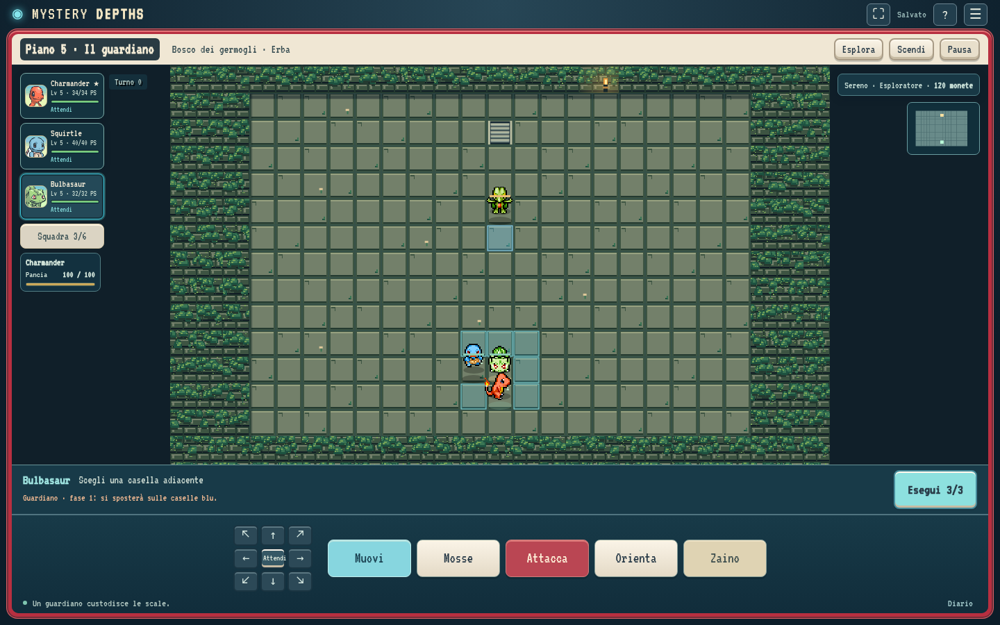

# Mystery Depths

Gioco roguelite locale in italiano: 29 starter, dungeon procedurali, combattimento
a turni, guardiani ogni cinque piani, mosse permanenti e provviste di spedizione.
Non richiede account né servizi esterni durante il gioco.

**Il gioco è utilizzabile, ma il requisito di identità completa a Esploratori del
Cielo non è soddisfatto.** Il calcolo dei danni usa `damage-eos` in WebAssembly;
il resto del motore non riproduce ancora tutte le regole originali. La matrice
[CONFORMITA.md](docs/CONFORMITA.md) elenca precisamente le differenze.
Nessun sito è stato pubblicato. Il codice è nel repository
[`andrea288/mystery-depths`](https://github.com/andrea288/mystery-depths).
Il proprietario gestisce la visibilità nelle impostazioni GitHub.

Per scaricare solo il gioco pronto all’avvio: [mystery-depths-gioco.zip](downloads/mystery-depths-gioco.zip) .
Il repository contiene anche sorgenti, fonti e test.

## Avvio

Serve **Node.js 22 o successivo**. Codice, dati, sprite e WebAssembly sono inclusi;
per giocare non serve installare pacchetti o compilare C++.

```sh
npm start
```

Aprire `http://127.0.0.1:4173`. Il server accetta connessioni solo dalla macchina
locale. Chiudere con Ctrl+C. Su Windows fare doppio clic su `avvia-windows.bat`;
su Linux/macOS eseguire `./avvia-linux-mac.sh`. Lo script Windows è predisposto,
ma non è stato eseguito su una macchina Windows in questa sessione.

## Restyling Pokédex tattico

Interfaccia rossa e avorio, dungeon pixel art e HUD a piena finestra. Squadra,
zaino e gestione si aprono in pannelli laterali; mosse a scomparsa e comandi
touch adatti anche al telefono in orizzontale.
[Guida al nuovo HUD e ai pannelli](docs/UX-HUD.md).
[Comandi, dettagli grafici e verifiche](docs/RESTYLING-TATTICO.md).



## Squadra e boss tattici

Recluta una specie sconfitta alla fine di ogni piano: fino a 6 Pokémon nella
squadra e 3 in campo. Nei piani normali gli alleati sono autonomi; contro i boss
schieri la formazione nelle tre righe inferiori e assegni un ordine a ciascuno
prima di confermare il turno. Lo starter resta obbligatorio: il suo KO termina
la spedizione. I Pokémon reclutati si sbloccano anche come starter.

Ci sono 18 guardiani e biomi legati ai tipi, inclusa un'estensione Folletto.
[Guida completa a squadra, comandi e regole](docs/SQUADRA-E-GUARDIANI.md).

## Espansione: 20 aggiunte

128 specie, evoluzioni facoltative, esperienza condivisa, tattiche degli alleati,
strumenti tenuti, cure mirate, anteprime e fasi dei boss, meteo, terreni, stanze
speciali, mercanti, soccorsi, scoperte persistenti e sfide con seed condivisibile.
[Elenco delle 20 funzionalità, comandi e limiti](docs/MIGLIORAMENTI-20.md).

## Animazioni e strumenti

Le 57 mosse disponibili hanno sequenze più lente e leggibili con anticipazione, effetti e
risposte nemiche in successione. Sono inclusi 25 fogli di effetti locali e
12 consumabili e 13 nuovi accessori/strumenti evolutivi. Dal menu Opzioni si possono scegliere quattro velocità,
minimappa, griglia, numeri dei danni, conferma strumenti e suoni sintetici.
Le 50 modifiche realizzate sono elencate in
[MIGLIORAMENTI-50.md](docs/MIGLIORAMENTI-50.md). I tempi sono adattati,
non identici fotogramma per fotogramma a EoS.

## Comandi e progressi

- Pulsante **Orienta**: tocchi/clic sulla mappa e pulsanti direzionali ruotano il Pokémon senza consumare turni. Clic destro sulla mappa: orientamento immediato.
- Frecce o WASD: movimento. Q/E/Z/C: diagonali. Maiusc + direzione: orientamento.
- Spazio: attacco normale. 1–4: mosse. Punto: attendi. Invio: scale. Esc: pausa.
- Fare clic su un nemico per mirare; passare su una mossa per vederne la portata.
- Strumenti dallo zaino; comandi touch sotto la mappa.
- Il menu consente esportazione/importazione JSON e ritorno al campo base.

L'archivio locale salva atomicamente due sezioni distinte: `meta`, con le mosse
permanenti per specie, e `run`, con PS, PP, strumenti, mappa e casualità.
Una nuova spedizione conserva la prima e ricrea la seconda. Non ci sono
salvataggi su server. Le versioni meccaniche incompatibili vengono rifiutate.

## Contenuti e fonti

Le regole di riferimento sono **EoS NA**, con denominazioni italiane ufficiali
estratte dai messaggi EU. I dati della serie principale non vengono usati per
statistiche, potenza, PP, precisione o apprendimenti. Le specie introdotte dopo
EoS usano conversioni esplicite, elencate in `data/post-eos-conversions.json`;
queste conversioni non sono comportamenti originali.

I 50 Pokémon hanno asset locali SpriteCollab con commit, hash e crediti.
Il renderer usa frame, durate, direzioni e ancoraggi delle ombre dei fogli.
Dieci specie non dispongono di Faint nella fonte: la dissolvenza di uscita
non viene presentata come animazione originale. Gli effetti visivi completi
delle mosse originali non sono riprodotti.

## Verifiche per sviluppatori

Servono anche Python 3.12, Git e compilatori C/C++. I test differenziali del
calcolatore richiedono l'adattatore nativo, generato dai comandi seguenti.

```sh
git submodule update --init --recursive
python3 -m venv .venv
.venv/bin/python -m pip install -r requirements-dev.txt
npm ci
.venv/bin/python scripts/test_native.py
.venv/bin/python scripts/build_live_wasm.py --native-only
.venv/bin/python scripts/rng_reference.py
npm test
.venv/bin/python scripts/verify_assets.py
.venv/bin/python scripts/extract_growth.py
```

Per ricompilare il WebAssembly impostare `EMSDK_ROOT` al percorso di Emscripten
3.1.29 ed eseguire `python scripts/build_live_wasm.py`. Il submodule originale
non viene modificato: l'adattatore RNG lavora su una copia in `build/live-eos`.

Con `npm start` attivo, Chromium installato e Playwright (`npm ci`):

```sh
node tests/browser/smoke.mjs
node tests/browser/journey.mjs
```

Le prove browser usano `/usr/bin/chromium` nell'ambiente Linux corrente.
La seconda gioca con input normali: selezione → esplorazione → combattimenti →
boss → ricompensa → ripresa → morte → nuova spedizione. Non modifica PS, nemici,
ricompense o salvataggi per superare gli incontri. Esamina una copia dello stato
per scegliere le azioni. I risultati sono in `test-results/`.

## Documentazione

[Specifica](docs/SPECIFICA.md) · [Stato](docs/STATO.md) ·
[Architettura](docs/ARCHITETTURA.md) · [Fonti](docs/FONTI.md) ·
[Conformità](docs/CONFORMITA.md) · [Verifiche](docs/VERIFICHE.md).

Il materiale originale dello ZIP è conservato in `research/handoff/`; le sue
vecchie formule di danno e reliquie non sono usate dalla simulazione corrente.
